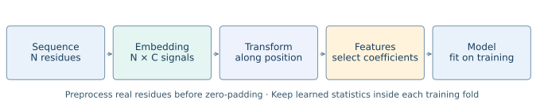

How the workflow fits together
==============================

A peptide is a sequence of residue identities, not a time series of measured
intensities. Protspect turns each identity into numerical channel scores, treats
the ordered scores as finite signals, and transforms those signals. The result
is a representation for analysis; its usefulness for a task requires evaluation.

The core matrix view
--------------------

.. figure:: _static/figures/sequence-matrix-spectral-analysis.png
   :alt: One-hot sequence rows multiply a residue-by-channel matrix, followed by a Fourier transform along the zero-padded sequence dimension.
   :width: 620px

   The project-provided illustration shows the core calculation.

A one-hot sequence has shape :math:`N\times20`, and its residue embedding
matrix has shape :math:`20\times C`. Multiplication produces :math:`N\times C`
ordered channel signals. Zero-padding adds **sequence rows**, giving
:math:`L\times C`. The Fourier transform then acts along the length axis,
independently for each channel: ``fft(padded_signals, axis=0)``. Neither the
20-residue alphabet axis nor the channel axis is transformed in this step.
Protspect performs the embedding by lookup, without allocating the one-hot
matrix. The :doc:`tutorials/sequence_signals` tutorial constructs both forms and
checks their equality. If centering or normalization is enabled, operate on
real embedded rows first and only then append all-zero rows.

Five decisions to make explicitly
---------------------------------

1. **Embedding.** Which residue properties define each channel? BLOSUM100 is a
   substitution-score profile, Kidera supplies ten statistical factors, and
   AAindex supplies properties or matrix profiles. These choices are not learned
   protein-language-model embeddings.
2. **Preprocessing.** Choose whether to center each sequence and how to scale it.
   Statistics over actual residues must precede padding. Dataset-level channel
   standardization, when enabled, must learn only from training chains.
3. **Transform.** Fourier/Z describe angular-frequency coefficients; Mellin
   uses positive residue positions and log-frequency; wavelets retain band and
   position. Their axes are not interchangeable.
4. **Features.** Export signed real/imaginary coefficients, magnitudes, phases,
   or aligned products. Select coordinates using their named axes.
5. **Evaluation.** Freeze the grid and representation policy, fit within CV,
   select models on training validation, and evaluate on held-out data.

The common objects
------------------

``transform_sequence`` and ``Sequence.compute_transform`` return a
``TransformResult`` containing channel arrays, coordinate arrays, and metadata.
``SequenceSet`` shares a grid across many sequences. ``ComplexSet`` applies the
same transform to each chain and forms ordered coefficient products.
``SequenceTransformer`` performs this featurization in sklearn and freezes
training-only state. Existing FFT names adapt to this implementation.

Fixed grids and honest comparisons
----------------------------------

A common length keeps output columns aligned, but padding is still a modelling
choice. More bins can sample an existing Fourier response more densely without
creating new sequence information. A wavelet filter and boundary rule determine
coefficient count. Channel count and feature count affect MLP parameter count.
Keep these differences visible when comparing models.

These are descriptors, not physical interaction energies, causal explanations,
or a guarantee of length or scale invariance. Magnitudes discard phase;
wavelet magnitudes also discard coefficient signs. Cross-products inherit
preprocessing and scaling. See :doc:`tutorials/features` for what each choice
retains and loses.
