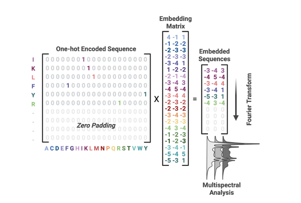

Protspect
=========

.. image:: _static/protspect-logo.png
   :alt: Protspect rainbow spectrum wordmark.
   :class: project-logo
   :width: 650px

**Protein sequence spectral analysis**

Turn residue-property signals into reproducible features for proteins and peptides.
Choose an embedding, apply a transform, and export coefficients or aligned channel
products through one API. Use the same workflow for individual sequences, sequence
collections, paired chains, and fitted machine-learning pipelines.

.. raw:: html

   

     <a class="primary-action" href="getting_started.html">Start here</a>
     <a href="tutorials/index.html">Follow a tutorial</a>
     <a href="examples/index.html">Open a notebook</a>
     <a href="api/index.html">Browse the API</a>
   

   

     
<strong>Choose residue channels</strong>
BLOSUM100, ten Kidera factors, AAindex1 properties, AAindex2/3 matrix profiles, or your own mapping.

     
<strong>Choose a transform</strong>
Fourier, circular Z, finite discrete Mellin, or discrete wavelets, with explicit axes and preprocessing.

     
<strong>Keep collections and pairs</strong>
SequenceSet and ComplexSet share coefficient export and coordinate-aware selection.

     
<strong>Fit within the training fold</strong>
SequenceTransformer freezes grids, channel moments, selection, and feature names for sklearn pipelines.

   

.. important::

   This site documents the **development checkout**. PyPI ``Protspect==0.1.0a1``
   predates Kidera, AAindex, alternative transforms, and the unified API.
   Follow :doc:`getting_started` to install the code these tutorials use.
   The import is ``protspect``; it is separate from the language-model prototype
   and the unrelated ``prospect`` and ``ProSpect`` distributions.

   One-hot residues become channel signals through a matrix multiplication.
   The Fourier transform acts along sequence rows, independently per channel.
   :doc:`framework` explains the shapes and the zero-padding convention.

.. testcode::

   from protspect import SequenceSet

   sequences = SequenceSet(method="fourier", compute_cross_spectra=False)
   sequences.from_sequence_list(["ACDE", "ACDF"], length=8)
   table = sequences.export_features("amplitude")
   assert table.shape == (2, 160)

Where to begin
--------------

New to spectral features? Read :doc:`framework`, then :doc:`tutorials/sequence_signals`.
For modelling, follow :doc:`tutorials/machine_learning` before the
:doc:`tutorials/antimicrobial_mlp` benchmark. For comparisons between residue
representations, explore :doc:`tutorials/embedding_atlas`.

.. toctree::
   :maxdepth: 2
   :caption: Learn and use

   getting_started
   framework
   tutorials/index
   examples/index
   api/index
   technical_guides
   contributing
