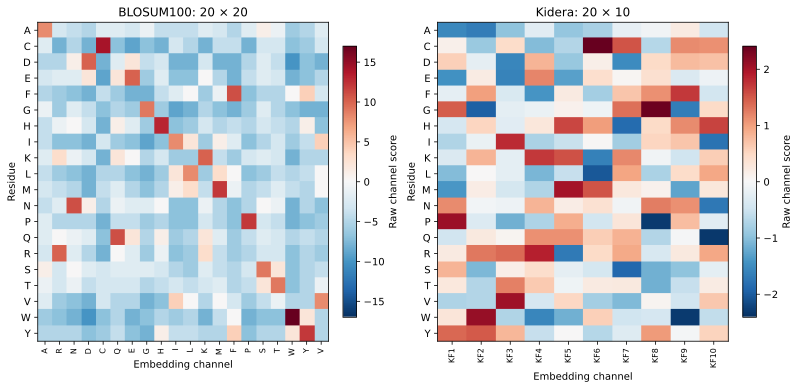

Choose residue representations
==============================

An embedding is a mapping ``embedding[channel][residue]``. Every real residue
in a sequence needs one finite score in every selected channel. Channel identity
and residue identity are different axes; their order matters when constructing
an explicit matrix.

BLOSUM100 and Kidera
--------------------

   Raw substitution-score and factor scales differ. These heatmaps do not imply
   the two representations have interchangeable channel bases or units.

.. testcode::

   from protspect import SequenceSet
   from protspect.embeddings import b100, kidera_factors

   for embedding, channels in [(b100, 20), (kidera_factors(), 10)]:
       data = SequenceSet(embedding=embedding, method="fourier",
                          compute_cross_spectra=False)
       data.from_sequence_list(["IKLFYR", "ACDEFG"], length=16)
       assert data.export_features().shape == (2, channels * 16)

``b100`` and ``kidera`` are read-only mappings. ``kidera_factors()`` returns
fresh dictionaries suitable for customization and sklearn cloning. Factor signs
and published order are retained. See :doc:`../REPRESENTATIONS` for provenance.

AAindex1: one property per channel
----------------------------------

AAindex is user-managed input. Download deliberately, keep the source checksum,
then select named accessions. This example needs a local snapshot and is not run
by the offline documentation checks:

.. code-block:: python

   from protspect.aaindex import AAIndex, download_aaindex1

   # Explicit network action, only when you need a source snapshot:
   # download_aaindex1(".aaindex/aaindex1")
   catalogue = AAIndex.from_file(".aaindex/aaindex1")
   matches = catalogue.search("hydrophobicity", complete_only=True)
   embedding = catalogue.embedding(["KYTJ820101"])
   provenance = catalogue.metadata(["KYTJ820101"])

For reproducibility supply ``expected_sha256`` to ``from_file`` and retain the
metadata. Missing and constant profiles affect downstream analysis; the adapter
rejects missing selected scores rather than silently imputing them.

AAindex2/3: specify the matrix orientation
------------------------------------------

.. code-block:: python

   from protspect.aaindex import AAIndex2, AAIndex3

   substitutions = AAIndex2.from_file(".aaindex/aaindex2")
   embedding = substitutions.embedding("HENS920102", axis="rows")
   contacts = AAIndex3.from_file(".aaindex/aaindex3")
   # Choose a complete accession after inspecting contacts.search(...).

Rows as channels and columns as channels can differ for asymmetric matrices.
The adapter's canonical residue block is not the same as discarding native
axis provenance. Contact-potential scores become residue-profile descriptors;
no three-dimensional contact graph or pairwise energy calculation is inferred.

Custom channels
---------------

.. testcode::

   from protspect import transform_sequence

   toy_charge = {"charge_indicator": {"A": 0., "K": 1., "D": -1.}}
   result = transform_sequence("AKDA", toy_charge, method="z", length=8, radius=1.05)
   assert result.features()[0].shape == (8,)

This is an illustrative charge indicator, not a measured pH-dependent scale.
Unknown symbols raise; choose an explicit policy rather than broadening the
alphabet with invented scores. For quantitative redundancy analysis see
:doc:`embedding_atlas`.
