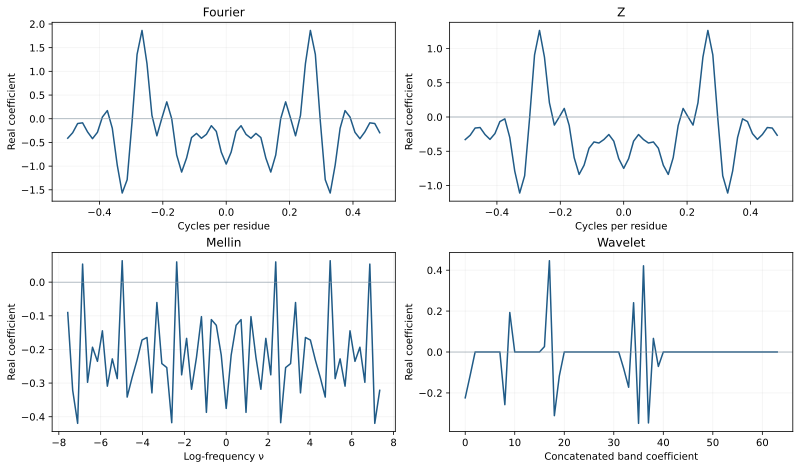

Compare the four transforms
===========================

All four methods receive the same ordered channel signals. They differ in the
kernel, positional weighting, boundary conventions, and meaning of coordinates.
The first comparison should make those conventions explicit rather than looking
only at visually similar curves.

   Same sequence and channel; different transform coordinates. Vertical scales
   and coordinate units are not a measure of relative predictive usefulness.

.. testcode::

   import numpy as np
   from protspect import transform_sequence
   from protspect.embeddings import kidera_factors

   options = {"fourier": {}, "z": {"radius": 1.05},
              "mellin": {"mellin_c": 0.0},
              "wavelet": {"wavelet": "haar", "level": 3,
                          "mode": "periodization"}}
   outputs = {method: transform_sequence("IKLFYR", kidera_factors(),
       method=method, length=32, **settings) for method, settings in options.items()}
   z_unit = transform_sequence("IKLFYR", kidera_factors(), method="z", length=32, radius=1.)
   np.testing.assert_allclose(z_unit.coefficients["KF1"], outputs["fourier"].coefficients["KF1"])
   assert "log_frequency" in outputs["mellin"].coordinates
   assert "band" in outputs["wavelet"].coordinates

Fourier
-------

The shifted DFT has a frequency axis in cycles per residue. Primary exports have
``length`` unique bins, including negative frequencies; real input gives
conjugate redundancy. More zero-padding samples the response more densely, not
more independently. No frequency selector is applied by default.

Circular Z
----------

The finite Z transform evaluates :math:`\sum_n x[n]z^{-n}` on a circle
:math:`z=r\exp(2\pi i f)`. Radius 1 equals Fourier. A radius above 1 downweights
later residues; below 1 upweights them exponentially. This is a sequence-origin
choice and can cause overflow, not a generic improvement on Fourier. The backend
does not expose arbitrary spiral contours.

Finite Mellin
-------------

The implementation evaluates the finite sum
:math:`\sum_n x[n](n+1)^{c-1-2\pi i\nu}`. Positions start at 1 to avoid log(0).
``mellin_c`` sets the real contour part; ``length`` freezes its log-frequency
grid. This is the documented unit-spacing quadrature convention, not an exact
continuous transform or automatic invariance to peptide length. Computation is
quadratic in input/grid size rather than an FFT on log-resampled data.

Discrete wavelets
-----------------

Choose ``wavelet``, ``level``, and ``mode``. Output order is approximation A at
the deepest level, then detail bands from deepest to finest. Coordinates label
band and within-band coefficient index; there is no single Fourier frequency
per coefficient. The level must fit the padded grid/filter support. Symmetric
extension may produce more coefficients than input length; periodization and
Haar can give equal width for a power-of-two grid.

Use signed ``real`` coefficients to retain wavelet signs. Amplitudes deliberately
discard them. For all backends, normalization is over real residues before
padding. See :doc:`../TRANSFORMS` for formulas and implementation details.
