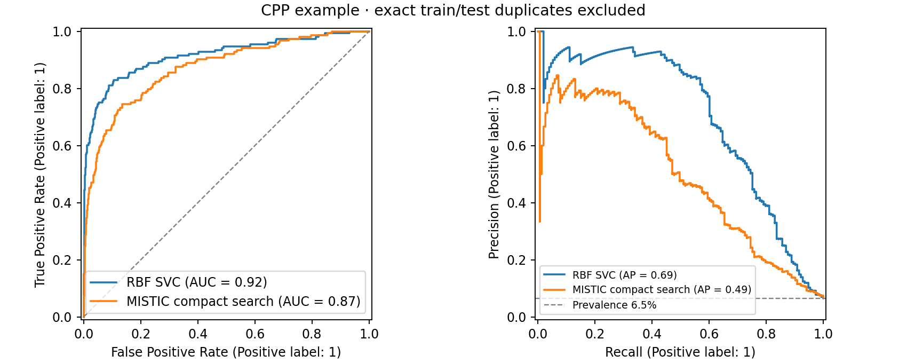
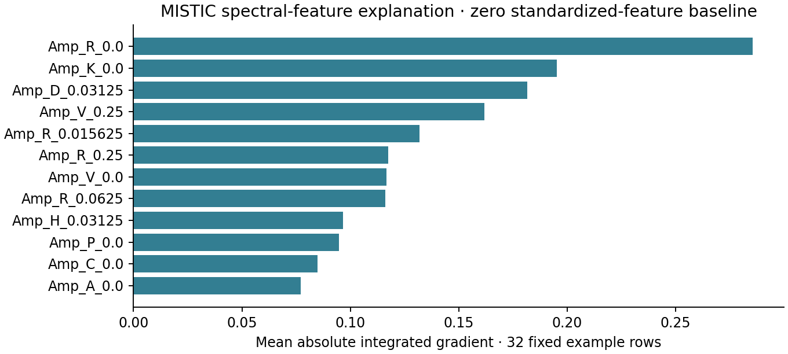

# CPP research example: complete official website data

Executed 2026-10-27 using the pinned CPython 3.12 research environment.
The active example uses the complete official MLCPP 2.0 Layer1 downloads.
Historical repository CSVs are not inputs. A second run produced an identical
complete report, selected settings/features, official identifiers, class
predictions, and decision scores (maximum difference 0.0).

| Algorithm | Balanced accuracy | MCC | F1 | ROC-AUC | Average precision |
| --- | ---: | ---: | ---: | ---: | ---: |
| rbf_svc | 85.78% | 0.481 | 0.479 | 0.915 | 0.692 |
| mistic | 77.77% | 0.295 | 0.286 | 0.871 | 0.495 |

The final MISTIC search selected rank weight 0.5 and 35 spectral features.
The RBF baseline selected {'C': 1.0, 'gamma': 0.01}.

The website snapshot contains **1,146 training records** (573 positive and
573 negative) and **2,341 test records** (157 positive and 2,184 negative).
The evaluation excludes four positive test records that also occur in training,
retaining **2,337 test records** (153 positive and 2,184 negative). No other
official records are omitted. Downloaded and prepared data retain the original
website record order and official identifiers.

These are compact tutorial results, not a reproduction of historical scores or
an identical reproduction of the paper evaluation. Related peptide families may
still cross splits. Both algorithms and search budgets were fixed before this
run; no settings were changed in response to test scores. Source record order
also defines the seeded training/validation split, so these results are not a
controlled comparison with the old, differently ordered repository CSVs.

Artifacts:

- [Executed notebook](../validation/cpp_official_run/CPP_reproducible.executed.ipynb).
- [Complete run report](../validation/cpp_official_run/report.json).
- [Replay verification](../validation/cpp_official_run/reproducibility_check.json).
- [Official source manifest](mlcpp2-source.json).
- [Data preparation and provenance](DATA_PROVENANCE.md).
- [Environment and protocol](README.md).

