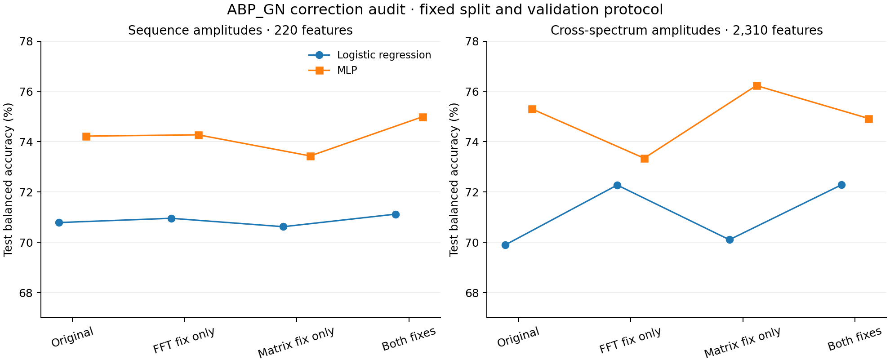

# ABP_GN: scientific validation of the corrections

Run date: 2026-10-27. This is an exploratory audit on the previously studied split.

## Main results

Classifier hyperparameters were selected separately for each representation using only
the stratified training validation partition. Results use the full training refit
and the supplied test set at probability threshold 0.5.

| Features | Classifier | Original BA | Corrected BA | Change (pp), paired 95% CI |
| --- | --- | ---: | ---: | ---: |
| amplitude | linear | 70.79% | 71.12% | +0.33 [-1.47, +2.14] |
| amplitude | nonlinear | 74.22% | 74.99% | +0.77 [-1.22, +2.70] |
| cross_amplitude | linear | 69.89% | 72.29% | +2.39 [+0.31, +4.48] |
| cross_amplitude | nonlinear | 75.30% | 74.93% | -0.38 [-2.45, +1.63] |

## Nonlinear classifier ablation

| Features | Variant | BA | MCC | ROC-AUC | Average precision | Hidden units; alpha |
| --- | --- | ---: | ---: | ---: | ---: | --- |
| amplitude | legacy | 74.22% | 0.480 | 0.821 | 0.740 | [64]; 0.0001 |
| amplitude | fft_fix_only | 74.27% | 0.486 | 0.810 | 0.725 | [128, 64]; 0.001 |
| amplitude | matrix_fix_only | 73.43% | 0.466 | 0.819 | 0.730 | [64]; 0.0001 |
| amplitude | corrected | 74.99% | 0.496 | 0.822 | 0.744 | [128, 64]; 0.0001 |
| cross_amplitude | legacy | 75.30% | 0.499 | 0.832 | 0.767 | [128, 64]; 0.0001 |
| cross_amplitude | fft_fix_only | 73.34% | 0.472 | 0.793 | 0.680 | [64]; 0.001 |
| cross_amplitude | matrix_fix_only | 76.23% | 0.519 | 0.836 | 0.778 | [128, 64]; 0.001 |
| cross_amplitude | corrected | 74.93% | 0.499 | 0.825 | 0.748 | [128, 64]; 0.001 |

## Historical reference scores

These are saved results, not newly retrained models. Test sequence order and labels
were checked against the prior predictions and match. Feature definitions differ.

| Earlier representation | Classifier | BA | MCC | ROC-AUC | Average precision |
| --- | --- | ---: | ---: | ---: | ---: |
| blosum | linear | 69.55% | 0.387 | 0.755 | 0.646 |
| blosum | nonlinear | 74.59% | 0.491 | 0.818 | 0.708 |
| blosum_dyadic_cross_spectral | linear | 72.01% | 0.443 | 0.792 | 0.707 |
| blosum_dyadic_cross_spectral | nonlinear | 76.27% | 0.523 | 0.846 | 0.789 |
| esm2_8m | linear | 75.69% | 0.509 | 0.850 | 0.796 |
| esm2_8m | nonlinear | 75.80% | 0.516 | 0.840 | 0.755 |

## Interpretation and limits

- With the nonlinear classifier, corrected sequence amplitudes score 74.99%
  balanced accuracy versus 74.22% originally; corrected cross amplitudes score
  74.93% versus 75.30%. Both paired intervals include zero, so this run does not
  establish a nonlinear performance gain or loss. Linear cross amplitudes improve
  by 2.39 percentage points (unadjusted paired 95% interval +0.31 to +4.48).
- No classifier convergence warnings were recorded.
- The corrections restore the stated mathematical frequency semantics and the
  reference substitution scores. Their validity does not depend on improving prediction.
- Corrected sequence amplitudes and corrected cross-spectrum amplitudes must not
  be treated as the earlier real/imaginary cross-spectrum representation.
  In particular, `abs(X_i * conjugate(X_j)) = abs(X_i) * abs(X_j)`: the
  amplitude-only cross representation contains quadratic magnitude interactions,
  but loses relative phase. The earlier strongest cross-spectrum model retains
  real and imaginary components, excludes DC, and uses a different frequency set.
- The original bug changed which coefficients were exported, not the FFT itself.
  Existing classifiers can exploit those coefficients even when their frequency labels
  are wrong. A loss of predictive performance does not justify retaining wrong labels.
- Both changes affect feature values, so recomputation and retraining remain required.
- Data: 3,562 training peptides (1,930 positive), 1,973 test peptides (826 positive).
  Maximum length is 255 residues; FFT length is fixed at 1,024, with no truncation.
  No exact sequence duplicates occur within or across the supplied splits.
- Seed 7, 713 validation examples, four hyperparameter candidates per classifier,
  training-only StandardScaler, raw amplitudes, and the default dyadic/DC selector.
  Feature counts remain identical across the four variants.
- The paired bootstrap intervals use 5,000 stratified test resamples and do not
  include fitting variability, model-selection variability, or homology structure.
  No correction for multiple contrasts was applied. The test set was already used
  in previous experiments. Treat small differences as tentative.
- Next confirmation should use repeated training seeds and a sequence-family-disjoint
  or new external test set, with the representation and selection policy fixed first.

## Reproducibility

See [the run report](abp_gn_fft1024_seed7/report.json),
[all metrics](abp_gn_fft1024_seed7/metrics.csv),
[predictions](abp_gn_fft1024_seed7/test_predictions.csv),
and [the run instructions](README.md). Exact input files and source files are hashed;
split indices and ordered feature names are saved. The benchmark checks the
legacy calculation against the upstream source in its regression tests.

