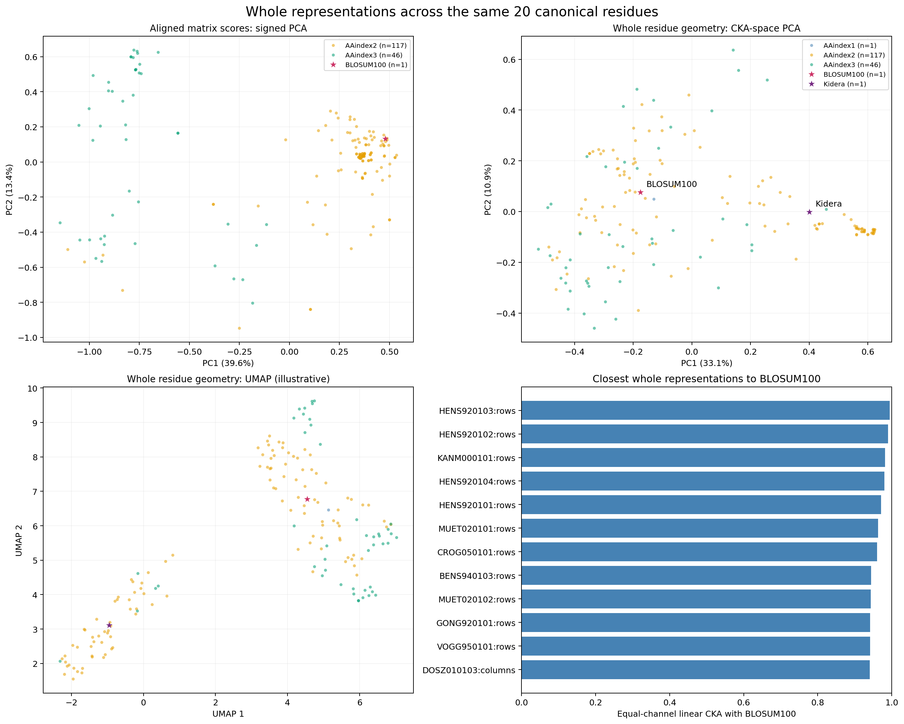
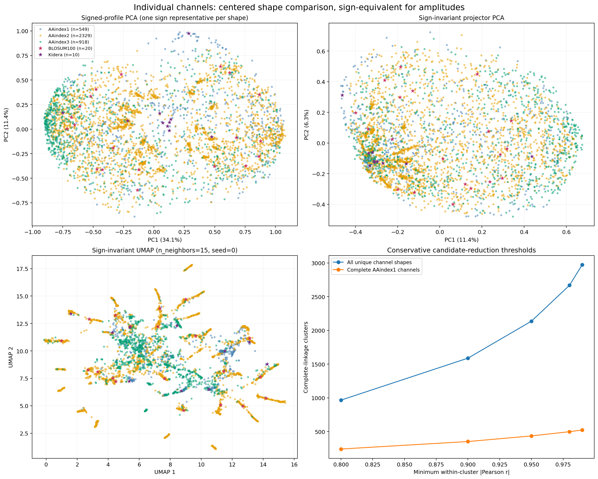
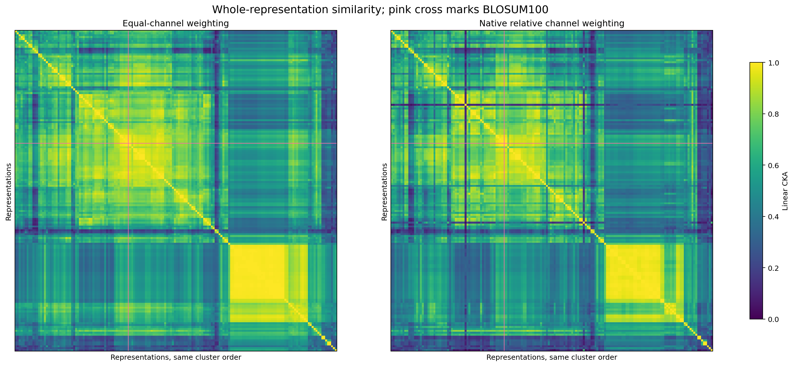
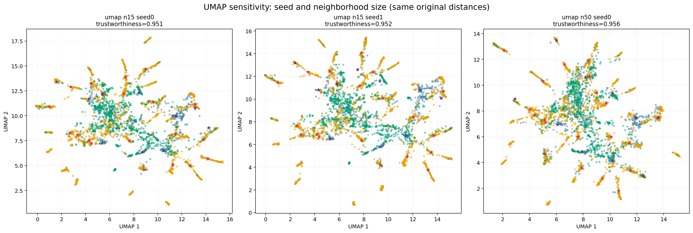
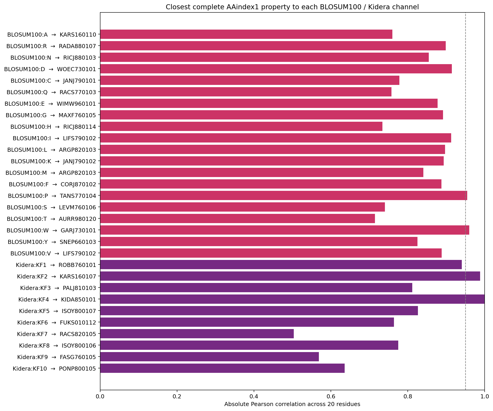

# Residue-embedding comparison results

This study compares embeddings directly, without peptide labels. It covers
BLOSUM100, Kidera, AAindex1, AAindex2, and AAindex3 using the same canonical
20-residue order. [Reproducible methods and commands](../../research/embedding_atlas/README.md).

## Main results

- **Individual channels:** 6,051 valid source/axis instances collapse to 3,826
  distinct centered, unit-scaled shapes after accounting for sign and exact
  duplicates (ten-decimal rounding). This includes 553 AAindex1 channels, 20
  BLOSUM100 channels, 10 Kidera factors, 3,750 AAindex2 profiles, and 1,718
  AAindex3 profiles. Missing/constant exclusions are recorded individually.
- **Whole representations:** 166 configurations, including BLOSUM100, Kidera,
  the complete AAindex1 family, and complete matrix blocks. Asymmetric row and
  column orientations are retained separately; identical symmetric orientations
  count once. Whole matrices with missing canonical values are excluded.
- **BLOSUM100 neighbors:** BLOSUM80 (`HENS920103`) has CKA **0.99485**;
  BLOSUM62 (`HENS920102`) **0.98988**; `KANM000101` **0.98223**; BLOSUM50
  (`HENS920104`) **0.98018**. Native-weight CKA is similar for these closest
  neighbors, indicating that the conclusion is not just channel equalization.
- **Kidera differs from BLOSUM100:** CKA **0.56661**. Its effective rank is
  approximately **10.00**, compared with **8.31** for BLOSUM100, despite
  BLOSUM100's larger number of channels. This describes residue geometry,
  not comparative predictive performance.
- **A useful exact match:** Kidera factor 4 and AAindex `KIDA850101` have
  correlation **1.00000**, confirming they are the same normalized hydrophobicity
  direction. Factor 2 is strongly related to `KARS160107` (diameter), **r=0.98796**.
  Several other Kidera factors have much weaker single-AAindex matches; e.g.
  factor 7's strongest match is **|r|=0.50350**. The full factor set is not simply
  ten duplicate AAindex choices.

## Conservative search-space reduction

Complete linkage uses original sign-invariant distances. Every pair within a
vector cluster satisfies the listed absolute-correlation threshold.

| Minimum within-cluster \|r\| | AAindex1 representatives from 553 channels | Representatives across 3,826 unique shapes |
| --- | ---: | ---: |
| 0.80 | 242 | 967 |
| 0.90 | 353 | 1,589 |
| 0.95 | 436 | 2,137 |
| 0.98 | 499 | 2,669 |
| 0.99 | 524 | 2,974 |

At whole-representation CKA ≥0.95, 166 configurations form **106** complete-linkage
clusters. This threshold is a geometry criterion; it is different from the
individual-vector correlation criterion.

Strict redundancy removal therefore helps, but does **not** justify reducing
AAindex1 to 30–60 interchangeable channels. Obtaining such a small pool would
require more aggressive approximation or task-specific selection. Exported
medoids provide reproducible starting pools for a subsequent MISTIC benchmark;
aliases and within-cluster alternatives should remain available for refinement.

## Visualizations

The aligned-score PCA preserves matrix labels/signs; the CKA views compare
residue geometry across different channel counts. Their differences are useful:
shared residue geometry need not mean identical channel-wise amplitudes.

Individual plots show one point per unique shape; shared-source points use a
reference-priority color. All original source aliases remain in the catalogue.

Each figure also has a vector PDF beside its PNG. A locally generated
[interactive atlas](interactive_atlas.html) supports hover, zoom, source-ID
lookup, alias inspection, and whole-geometry neighbors. Regenerate it from the
committed CSVs using `research.embedding_atlas.interactive`; the large bundled
viewer is not committed. Browser interaction testing was unavailable because the
browser security policy blocks local file URLs; figure PNGs were visually checked.

## Quantitative layout diagnostics

The first two projector-PCs explain only **17.74%** of vector variation. Whole
CKA PCA explains **43.94%**; aligned matrix-score PCA explains **52.98%**. Do not
infer original pairwise distances from proximity in a two-dimensional panel.

Vector UMAP at 15 neighbors/seed 0 has audited trustworthiness **0.9514**, but
retains only **39.9%** of original top-ten neighbors. Seed 1 gives **0.9525** and
**40.3%**; 50 neighbors gives **0.9558** and **33.7%**. Thus useful neighborhood
structure is visible, but the plots cannot substitute for the original-space
similarity tables or define discrete clusters. Full metrics are in `report.json`.

A same-environment replay reproduced the vector coordinates, whole coordinates,
similarity matrix, and source catalogue **exactly**, including all three seeded
vector UMAP layouts. This is a reproducibility check, not evidence that UMAP's
layout is uniquely meaningful.

## Outputs

- [Full source/channel catalogue and cluster assignments](vector_catalogue.csv)
- [AAindex1-only medoids at |r|≥0.95](aaindex1_representatives_r095.csv)
- [All-channel medoids at |r|≥0.95](vector_cluster_representatives_r095.csv)
- [BLOSUM100/Kidera channel neighbors](reference_vector_neighbors.csv)
- [Whole-representation neighbors of BLOSUM100](whole_neighbors_b100.csv)
- [Equal-channel CKA matrix](whole_cka_equal_channels.csv)
- [Native-weight CKA matrix](whole_cka_native_weights.csv)
- [Aligned matrix-score correlations](aligned_matrix_score_correlations.csv)
- [Input hashes, parameters, and environment](report.json)
- [Replay check](reproducibility_check.json)

Mean removal and unit scaling define shape similarity, not equivalence under
Protspect's raw defaults. AAindex units, offsets, and signs remain available in
the underlying sources; phase/cross-spectrum behavior can differ. All similarity
results use equal weights for the 20 residue types, rather than the composition
of a particular peptide dataset. No claim of improved downstream performance is
made, and no raw AAindex database is bundled with these derived outputs.
